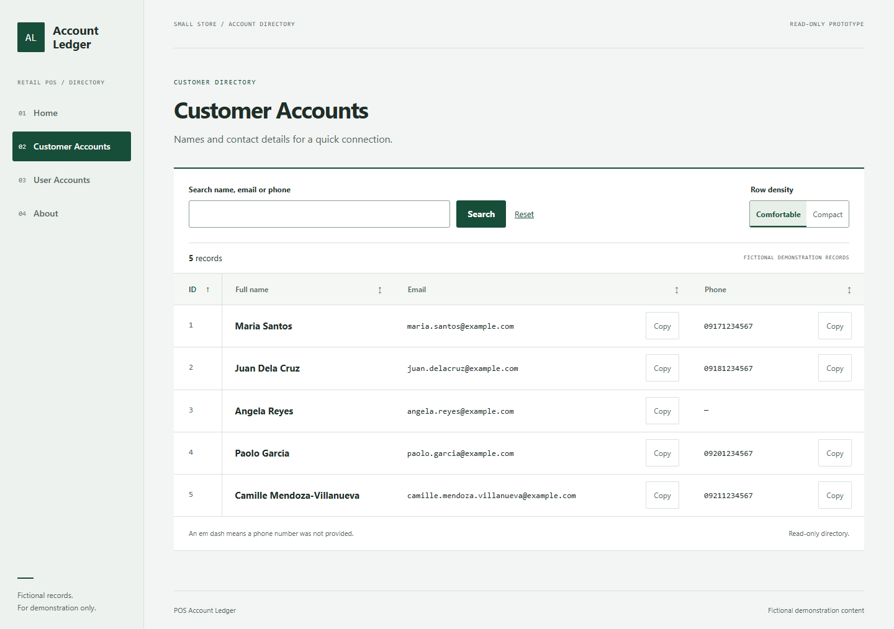

# POS Account Ledger

**Deploy this repository:** follow [the Render + Clever Cloud walkthrough](DEPLOYMENT.md) for `howardcallanta00-ship-it/account-ledger-tfa6`.

A read-only Laravel 12 / Blade / MySQL directory for small-store staff. Customer and user records come from Eloquent. All seeded names and contact details are fictional. The application has no authentication, writes, payments, inventory, or uploads.



[View the mobile layout](docs/screenshots/customers-mobile.png) · [Deployment walkthrough](DEPLOYMENT.md) · [Verification details](VERIFICATION.md)

## Design and scope

Three approaches were considered: **Account ledger** (navigation rail and ruled records), **Retail counter** (horizontal navigation and receipt typography), and **Directory index** (split editorial layout and large names). Account ledger was selected for repeated browsing.

The design contract is a quiet store reference book: compact numbered navigation, a broad white records surface, narrow monospaced ID gutter, prominent sans-serif names, cool off-white background, charcoal text, readable gray-green supporting text, pale rules, and deep-green selection. There are no remote fonts or decorative animations. Mobile uses a compact navigation header and bounded table scrolling.

Exactly four UX improvements: submitted GET search, allowlisted column sorting, copy controls with honest feedback, and persistent comfortable/compact density. Exactly four UI improvements: ledger composition, purposeful typography, coherent colors/states, and deliberate mobile composition.

## 1. Prerequisites and installation

- PHP **8.4** with PDO MySQL, mbstring, OpenSSL, fileinfo, ctype, DOM, XML, tokenizer, and zip. SQLite extensions are needed only for the default fast test suite.
- Composer 2 and MySQL 8.0+ (8.4 recommended locally).
- Alternatively, Docker for the provided Apache/PHP image.
- No Node, npm, Vite server, or frontend compilation is needed. Finished CSS and JavaScript are versioned in `public/assets` and copied into the image.

From the application directory:

```sh
composer install
cp .env.example .env
php artisan key:generate
```

Windows PowerShell can use `Copy-Item .env.example .env`. Never commit `.env`, credentials, keys, or certificates. Generate an application key once per environment. Never regenerate a production key on startup.

## 2. Local MySQL setup

Using a local MySQL administrator, create a dedicated database and user. Replace the password locally before executing:

```sql
CREATE DATABASE pos_account_ledger CHARACTER SET utf8mb4 COLLATE utf8mb4_unicode_ci;
CREATE USER 'ledger'@'localhost' IDENTIFIED BY 'replace-with-a-strong-local-password';
GRANT ALL PRIVILEGES ON pos_account_ledger.* TO 'ledger'@'localhost';
```

Set the corresponding `DB_HOST`, `DB_PORT`, `DB_DATABASE`, `DB_USERNAME`, and `DB_PASSWORD` in `.env`. The default host is `127.0.0.1`; ensure the MySQL account accepts that host on your installation. Quote environment values containing spaces or `#`.

```sh
php artisan migrate
php artisan db:seed
php artisan db:seed
php artisan serve
```

Open `http://localhost:8000`. `php artisan serve` is for local development only. Running seeders again preserves existing seeded rows and unrelated rows. Customers use their fixed demonstration email as the seed lookup; the schema deliberately does not make customer email unique. User seeds use unique usernames. `created_at` is maintained by Eloquent; `updated_at` is disabled.

The only application tables are `customers` and `users`; Laravel also maintains its `migrations` bookkeeping table. Sessions and cache are in-memory `array` drivers, and queues use `sync`, so no session, cache, job, token, or password tables are created. The directories do not depend on local state surviving a restart.

## 3. Environment variables

| Variable | Production setting |
| --- | --- |
| `APP_NAME` | `POS Account Ledger` (optional; default comes from config) |
| `APP_ENV` | `production` |
| `APP_DEBUG` | `false` |
| `APP_URL` | Actual `https://YOUR-SERVICE.onrender.com` URL |
| `APP_KEY` | Persistent value generated once with `php artisan key:generate --show` |
| `DB_CONNECTION` | `mysql` |
| `DB_HOST` | Clever Cloud **external** host |
| `DB_PORT` | Clever Cloud external port; do not assume 3306 |
| `DB_DATABASE` | Clever Cloud database name |
| `DB_USERNAME` | Clever Cloud user |
| `DB_PASSWORD` | Clever Cloud password, entered securely |
| `MYSQL_ATTR_SSL_CA` | Trusted provider CA file path, when provider-supported TLS is confirmed; see below |
| `LOG_CHANNEL` | `stderr` |
| `LOG_LEVEL` | `warning` |
| `SESSION_DRIVER` | `array` |
| `CACHE_STORE` | `array` |
| `QUEUE_CONNECTION` | `sync` |
| `PORT` | Assigned by Render; do not override. Local image default: 10000 |

Leave `DB_URL` unset; a stale URL can override separate DB settings. The app trusts the hosting proxy's forwarded protocol so links/assets use HTTPS. The container must remain behind that proxy; do not expose this trust configuration directly to the public internet outside the documented architecture.

## 4. Create the free Clever Cloud database

1. Sign in at the [Clever Cloud Console](https://console.clever-cloud.com/).
2. Create an add-on, choose **MySQL**, and explicitly select **DEV / free**. Confirm the price is zero and there is no temporary paid trial. Do not create a Clever Cloud application.
3. If DEV is unavailable for your account or region, stop and record the exact provider message. Do not substitute XS or another paid plan.
4. Copy the supplied **external** host, port, database, username, and password into a secure local environment file and later Render's environment settings. Clever Cloud normally names these `MYSQL_ADDON_HOST`, `MYSQL_ADDON_PORT`, `MYSQL_ADDON_DB`, `MYSQL_ADDON_USER`, and `MYSQL_ADDON_PASSWORD`; map their displayed values to the application's `DB_*` variables above. Use the console's actual labels/values as authoritative.

### Database transport security: deployment checkpoint

The [current MySQL provider documentation](https://www.clever.cloud/developers/doc/deploy/databases/mysql) confirms DEV is free but does **not** specify a verified TLS endpoint, CA, or external MySQL TLS setup for DEV. Its HTTPS certificate documentation concerns web applications and is not evidence of database TLS support. Account-specific TLS support has not been verified in this delivery.

Before sending credentials from Render over the public network, confirm the DEV external endpoint's supported TLS procedure and trusted CA with the console/provider. If available, add the CA as a Render **Secret File**, for example `mysql-ca.pem`, and set `MYSQL_ATTR_SSL_CA=/etc/secrets/mysql-ca.pem`; locally use an absolute trusted CA path. The PDO configuration enables server-certificate verification when a CA is supplied. Never set verification to false or trust an arbitrary downloaded certificate to bypass failure.

Verify with a trusted MySQL client using the provider's CA and hostname:

```sh
mysql --host=PROVIDER_HOST --port=PROVIDER_PORT --user=PROVIDER_USER --password --ssl-mode=VERIFY_IDENTITY --ssl-ca=/trusted/path/mysql-ca.pem PROVIDER_DATABASE
```

Inside that client, `SHOW SESSION STATUS LIKE 'Ssl_cipher';` must return a nonempty cipher. If DEV cannot provide verified TLS, report that as a deployment blocker and stop; do not silently downgrade the connection or switch to a paid service. Leaving the CA blank is supported for local development, but is not proof of secure remote transport.

## 5. Initialize the remote database without paid Render features

After the TLS checkpoint, use a trusted local machine with PHP/Composer. Create `.env.remote` containing the production variables and external DB settings. Keep it untracked. Use a separate empty database for tests; never run the test suite against the production database.

Laravel can load a selected environment file:

```sh
php artisan config:clear
php artisan migrate --env=remote --force
php artisan db:seed --env=remote --force
php artisan migrate:status --env=remote
php artisan ledger:check --env=remote --require-tls
```

Ensure exported shell `DB_*` variables are cleared or intentionally match `.env.remote`; real environment variables take precedence over files. Inspect the target database name before applying migrations. Seeders can be rerun explicitly when needed; startup never runs them.

If local PHP is unavailable, use Docker on a trusted machine:

```sh
docker build -t pos-account-ledger .
docker run --rm --env-file .env.remote --entrypoint php pos-account-ledger artisan migrate --force
docker run --rm --env-file .env.remote --entrypoint php pos-account-ledger artisan db:seed --force
```

When a private CA is needed, also mount it read-only in **each** invocation, e.g. `--mount type=bind,source=/absolute/trusted/mysql-ca.pem,target=/run/secrets/mysql-ca.pem,readonly`, and set `MYSQL_ATTR_SSL_CA=/run/secrets/mysql-ca.pem` in the container's env file. Neither the env file nor certificate belongs in the image. Docker `--env-file` values should not have surrounding shell quotes. `APP_KEY` can be generated once with `docker run --rm --entrypoint php pos-account-ledger artisan key:generate --show` and stored securely.

This procedure does not need Render shell access, a pre-deploy command, a worker, or a public migration URL. Never run a reset on deployment. If your database already has tables/data from a different application, inspect and back up first, then write reviewed forward migrations; this initial schema deliberately fails rather than dropping existing tables.

## 6. Create the Render Free Docker service

1. Put this application directory at the root of a Git repository you control and push it to a Git provider supported by Render. Include `composer.lock`, `public/assets`, `Dockerfile`, and `docker/`. Exclude `.env*` other than `.env.example`, database files, vendor, keys, and certificates.
2. In [Render](https://dashboard.render.com/), choose **New → Web Service**, connect that repository, and choose **Docker**. Alternatively create a Blueprint from `render.yaml`, which explicitly sets `plan: free`.
3. Explicitly choose the **Free** instance and confirm zero cost. No disks, paid builds, workers, Redis, cron, databases, or trial resources are needed. If Free is unavailable, stop and report the exact blocker.
4. Enter all production variables from the table securely. Generate `APP_KEY` once on a trusted machine and paste it; the Blueprint does not generate or rotate it. Set `APP_URL` to the assigned Render HTTPS URL. Add the provider CA secret file if supported, then its path variable.
5. Set health check path to `/up`. Use Dockerfile `./Dockerfile`. Leave Docker Command at its default. Do not add a pre-deploy command or migration command.
6. Deploy. Apache serves `public/`, Laravel receives application routes through `public/.htaccess`, and startup binds Apache to `0.0.0.0:$PORT`. Runtime paths are writable; access/error and application logs go to stdout/stderr. Dependencies are installed from the lockfile. Assets need no development server. The build does not connect to MySQL.

Set a zero spend limit wherever available and avoid attaching a payment method if you need suspension rather than overage charges. Review all service and usage settings; selecting free compute alone is not a guarantee against unrelated usage charges.

## 7. Verify the actual live service

`/up` confirms Laravel can respond; it does not query MySQL. After deployment:

1. Open HTTPS `/`, `/about`, `/customers`, and `/users`. Check that CSS/JS load over HTTPS and there is no mixed content or Vite dependency.
2. Confirm five fictional rows in each directory. Compare them with the remote database through a trusted client. Search customer name/email/phone and staff username/name. Sort every column in both directions; check query preservation and browser Back.
3. Test copy success/failure, compact density after reload, keyboard focus, and mobile table scrolling.
4. Manually restart or redeploy the application through Render. Revisit both account pages; the same records must still be present in Clever Cloud. Do not rerun seeds to disguise a persistence failure.
5. Check production debug is off. Review responses and logs without pasting secrets into chat. Confirm secrets were excluded from source/image build context, and both services still display their required free plans.
6. If an error occurs, expect a concise 503 directory page and a retry link; technical query bindings and credentials must not appear in its response or database-error log. Public migration/seeding URLs do not exist.

## 8. Testing and maintenance

```sh
composer validate --no-check-publish
php artisan test
php artisan view:cache
php artisan route:list
```

The default tests use isolated in-memory SQLite for speed. To verify exact MySQL types and run all tests, create a **dedicated disposable test database**, then export its settings before running PHPUnit (the environment wins over the defaults in `phpunit.xml`):

```sh
DB_CONNECTION=mysql DB_HOST=127.0.0.1 DB_PORT=3306 DB_DATABASE=ledger_test DB_USERNAME=ledger_test DB_PASSWORD=YOUR_TEST_PASSWORD php vendor/phpunit/phpunit/phpunit
```

On PowerShell use `$env:DB_CONNECTION='mysql'` and equivalent `$env:` assignments for the other test values, then invoke `php vendor/phpunit/phpunit/phpunit`. **RefreshDatabase clears test tables**; do not point it at production or a valued database.

The suite checks pages, exact MySQL schema, repeatable seeds, uniqueness, created timestamps, empty/no-match states, search fields, malicious/invalid parameters, all sorts, escaping, HTTPS forwarded headers, read-only routing, and safe database failures. See `VERIFICATION.md` for checks actually performed in this delivery.

GitHub Actions runs the MySQL suite and a separate production Docker build/smoke test on pushes to `main` and pull requests. The Docker job checks Apache routes, assets, response security headers and the database-unavailable page. It uses no hosting credentials. Check the actual workflow result in GitHub before treating it as passed.

Redeploy the same Docker configuration for code changes. Review and run new forward migrations from the trusted environment before code requiring them goes live. Keep `APP_KEY` and remote DB variables stable. Do not run seeds, resets, or key generation on every restart. Keep dependency/security updates reviewed and commit the resulting lockfile.

## 9. Troubleshooting and free-plan limits

- A first request may show Render's wake-up page: Free services sleep after 15 minutes of inactivity, and waking can take about a minute. Do not create keep-alive services.
- Render's local filesystem is ephemeral. Only Clever Cloud holds persistent records. In-memory session/cache state is disposable.
- Render currently documents 750 shared Free instance hours per workspace per month plus bandwidth/build limits. Usage exhaustion can suspend services or builds; external database traffic can also trigger a service-initiated traffic suspension. Do not upgrade to paid automatically.
- Clever Cloud DEV is for testing, with lower performance and no backups/SLA/extensions. Its documentation currently lists an EOL MySQL 8.0 DEV version; the available account plan/version must be checked during creation. Keep fictional records only and do not treat this as a production POS system.
- A 503 directory page: verify the external host/port, credentials, plan availability, TLS endpoint/CA, network access, and whether migrations ran. Check redacted log SQLSTATE, not raw credentials. `/up` succeeding does not prove the database is healthy.
- Build failure: verify the committed lockfile, PHP 8.4 platform compatibility, and `pdo_mysql`/mbstring. No Node build is required.
- Startup failure: check the persistent `APP_KEY` exists and Render's port is available. Do not regenerate keys to fix unrelated connection errors.
- Invalid query options return 422 with a reset path. Clipboard permissions may fail; values remain selectable. Storage denial leaves density usable for the current page.

Provider references, checked 20 October 2026: [Render Free](https://render.com/docs/free), [Render Docker](https://render.com/docs/docker), [Clever Cloud MySQL](https://www.clever.cloud/developers/doc/deploy/databases/mysql). Account-specific availability, billing, TLS, and live deployment are not verified here.

## Remaining account actions

Create/select the zero-cost Clever Cloud DEV add-on and confirm its external TLS/CA procedure; initialize it using the commands above. Push the source to a repository under your account. Create the Render Free Docker service, securely enter its persistent key, actual URL, DB connection settings and CA, deploy, and complete the live checklist. No authenticated Render/Clever Cloud access or database credentials were supplied for this task, so no live deployment URL is claimed.
